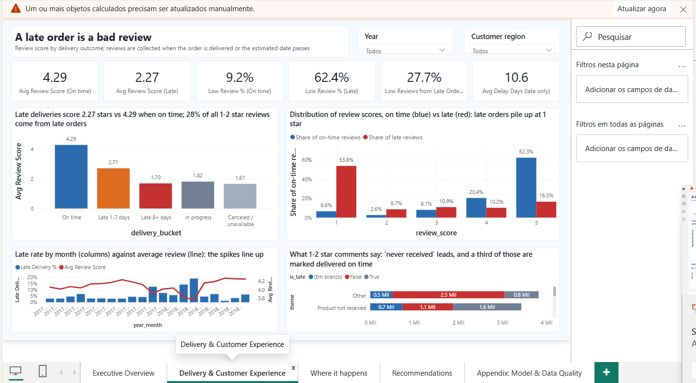
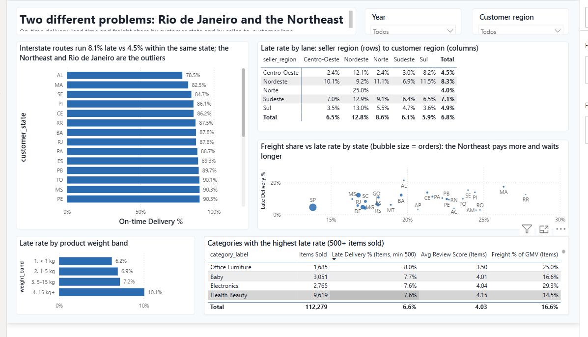
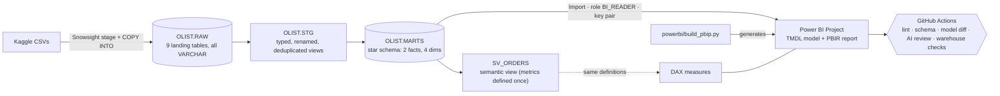

# Olist Delivery Experience — Snowflake → Power BI, versioned as code

[](https://github.com/dinsightsbr/olist-delivery-analytics/actions/workflows/ci.yml)
[](LICENSE)
[](#data-licence-and-credits)

A dashboard that answers one operations question on public e-commerce data — *is the delivery
experience hurting customer satisfaction, and where should we act first?* — built the way a
production analytics product would be:

- a **dimensional model and a semantic view in Snowflake** (RAW → STG → MARTS → `SV_ORDERS`),
- a **Power BI Project (PBIP)** — TMDL semantic model + PBIR report — **generated from code**, so the
  whole dashboard is reviewable text in Git,
- **reconciliation checks** that tie every headline number back to the warehouse, and
- a **CI pipeline** that lints the SQL, validates the report against Microsoft's PBIR schemas, posts a
  semantic-model diff on every pull request and asks an AI reviewer to read the SQL changes.

Dataset: [Olist Brazilian E-Commerce](https://www.kaggle.com/datasets/olistbr/brazilian-ecommerce)
(~100k orders, 2016–2018). The brand on the pages ("ROTA · Marketplace Analytics") is fictitious.

## Key findings (orders from Jan 2017 to Aug 2018)

| What the data says | Number |
| --- | --- |
| Sales grow, loyalty does not | R$ 13.5M GMV, 99k orders, **3.1 %** repeat customers |
| A late delivery is the most damaging experience | avg review **2.27** when late vs **4.29** on time; 62 % of late orders get 1–2 stars vs 9 % |
| "Delivered" is not "received" | 32 % of 1–2 star comments say *never received*; a third of those are orders marked delivered on time |
| Two different "where" problems | Rio de Janeiro: 2nd market, 87.8 % on time (same as Bahia, next door to the sellers). Northeast: 78–88 % on time, freight 20–26 % of GMV |
| The promise is padded | customers are told 24 days and receive in 12.5; the problem is variance by lane, not the average |

Full numbers, by-state table and the comment-theme analysis: [docs/findings.md](docs/findings.md).

<p align="center">
  
  
</p>

## Architecture



Business rules live in one place (`sql/30_marts.sql`): *delivered* = status `delivered` with a customer
delivery timestamp; *late* = delivered after the estimated date; *low review* = score 1–2. The DAX
measures mirror the semantic view name for name; when they disagree, the SQL wins.

## Repository layout

```
sql/                 00_setup → 10_raw → 20_stg → 30_marts → 40_semantic → 90_checks (+ 50_cortex, optional)
powerbi/
  build_pbip.py      generates the PBIP (tables, 52 measures, 5 pages, theme, background)
  validate_pbip.py   validates every report JSON against the official PBIR schemas
  measures.md        measure dictionary (human-readable twin of the TMDL)
  branding/          fictitious brand, page backgrounds (Pillow script)
  Olist Delivery Experience/   the PBIP: .pbip, .SemanticModel (TMDL), .Report (PBIR)
tools/               measure_diff.py (PR model diff) · run_checks.py (warehouse checks for CI)
docs/                findings.md (validated numbers and the story) · img/
.github/             CI workflow, AI review prompt, Dependabot, CODEOWNERS, PR and issue templates
```

## Run it yourself

1. **Snowflake** (a free trial works): run `sql/00_setup.sql`, upload the nine Kaggle CSVs to the
   `CSV_STAGE` stage in Snowsight, then run `10_raw`, `20_stg`, `30_marts`, `40_semantic` and `90_checks`.
   Every check in `90_checks.sql` must come back `TRUE`.
2. **Power BI Desktop**: open `powerbi/Olist Delivery Experience/Olist Delivery Experience.pbip`,
   set the parameters `SnowflakeServer` / `SnowflakeWarehouse` / `SnowflakeRole` if yours differ,
   refresh and sign in (the project assumes a service user with key-pair auth; see
   [powerbi/README.md](powerbi/README.md)).
3. **Change something**: edit `powerbi/build_pbip.py` (layout, measures) or `sql/`, run
   `python powerbi/build_pbip.py && python powerbi/validate_pbip.py`, open a pull request and let CI
   tell you what changed in the model.

```bash
python -m venv .venv && . .venv/bin/activate      # Windows: .venv\Scripts\activate
pip install -r requirements-dev.txt
pre-commit install
```

## DataOps: what runs on every pull request

| Job | What it proves |
| --- | --- |
| `sql-lint` | SQLFluff, Snowflake dialect — capitalisation, aliasing, references, structure (`.sqlfluff`) |
| `pbip-validate` | every `page.json` / `visual.json` / `report.json` validates against Microsoft's published PBIR schemas; then regenerates the project and reports drift between the generator and the committed files |
| `model-diff` | parses the TMDL at base and head and posts a sticky comment: measures added / removed / changed (with DAX diff) and relationship changes |
| `ai-sql-review` | sends the `sql/` diff to a model through [`actions/ai-inference`](https://github.com/actions/ai-inference) (GitHub Models, no extra secret) with a reviewer prompt (`.github/prompts/sql-review.md`); advisory comment, the human decides |
| `snowflake-checks` | on demand and weekly: key-pair login with a read-only service user, runs uniqueness / referential / reconciliation checks against `OLIST.MARTS`; can run on a self-hosted runner by setting the `SNOWFLAKE_RUNNER` variable |

Plus: Dependabot for pip and Actions, CODEOWNERS, PR and issue templates, `pre-commit` with SQLFluff and
gitleaks, `.gitattributes` pinning LF so Desktop saves do not produce whole-file diffs, deterministic
`lineageTag`s in the generator so regenerating yields reviewable diffs.

## Design principles

- One question per page; titles state the insight (several are DAX measures, so they update with the filters).
- Colour has meaning: grey context, one blue highlight, red only for *late*.
- Import mode on a pre-aggregated star schema; single-direction relationships; measures over calculated columns.
- Trust is explicit: the appendix page shows the lineage, the rules and the reconciliation table.

## Roadmap

- Tabular Editor Best Practice Analyzer and PBI-Inspector on a Windows runner.
- Release workflow: tag → zipped PBIP + findings as release assets; auto-generated measure dictionary published with GitHub Pages.
- Per-PR ephemeral Snowflake schema deploy (Snowflake CLI) before the checks run.
- Cortex `AI_CLASSIFY` for the comment themes (rule-based today; AI functions are not available on trial accounts).
- dbt port of `STG` and `MARTS` with tests, keeping the same naming.

## Data, licence and credits

Code in this repository is MIT licensed. The Olist dataset is © Olist, released on Kaggle under
**CC BY-NC-SA 4.0**; it is not redistributed here (`data/` is git-ignored) and nothing in this project is
commercial. Built by João Assis; every number was reconciled against the warehouse before use.
